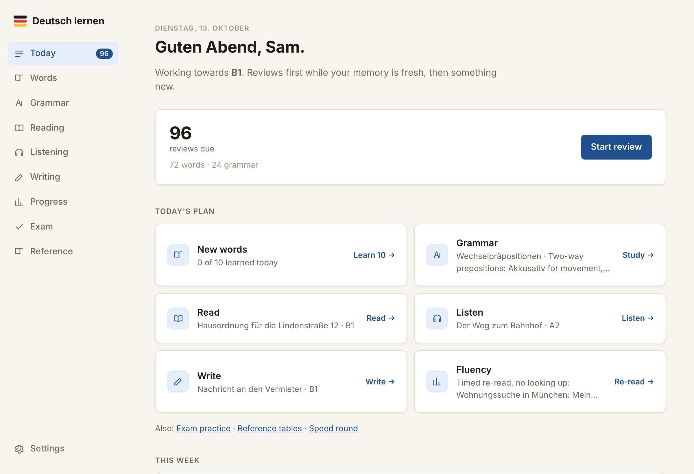
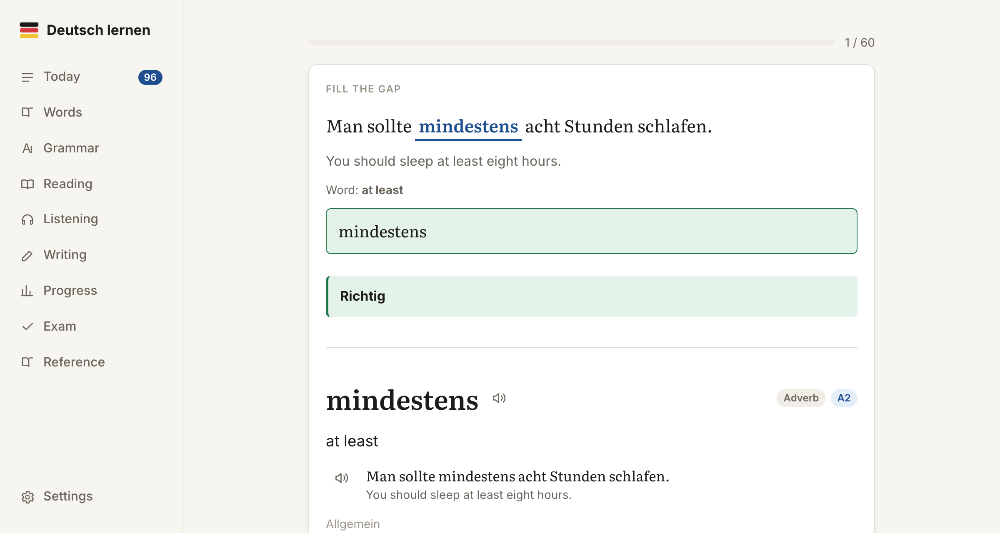
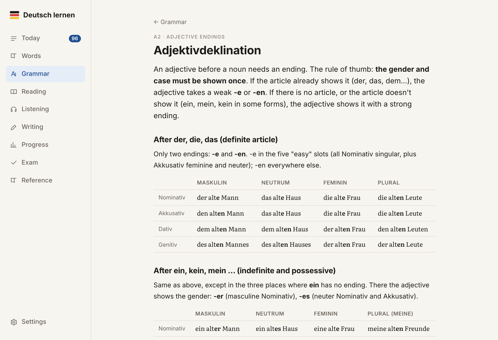
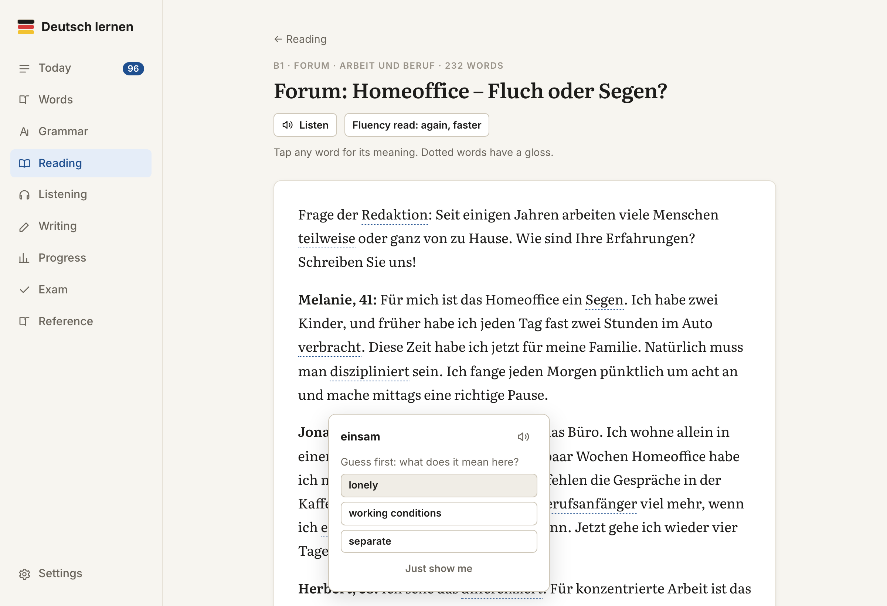
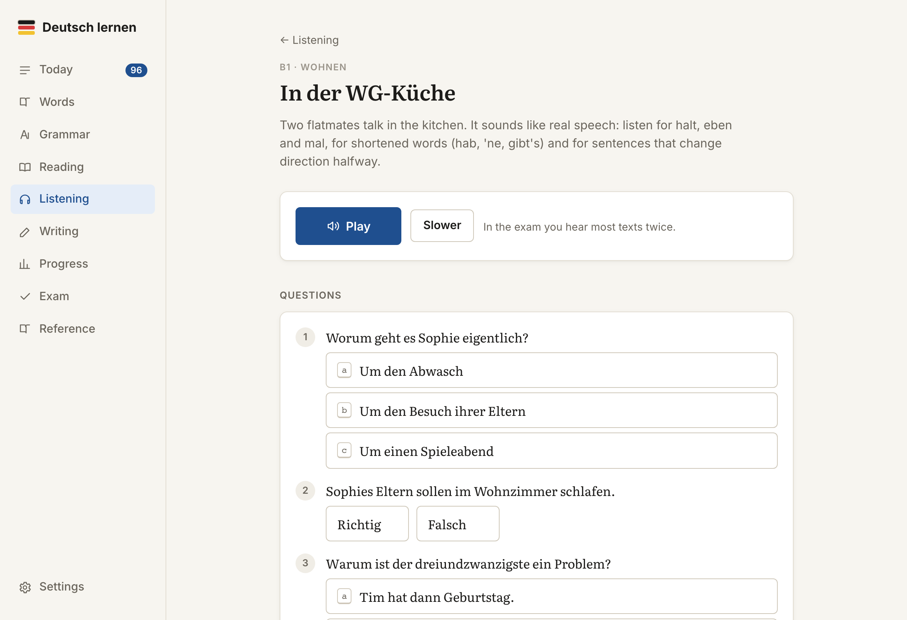
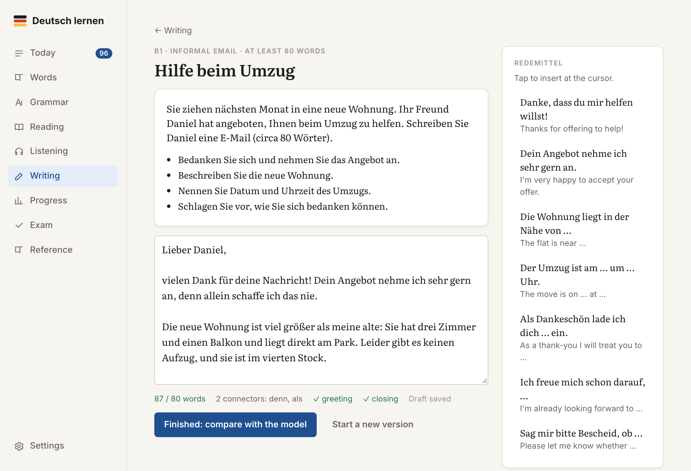
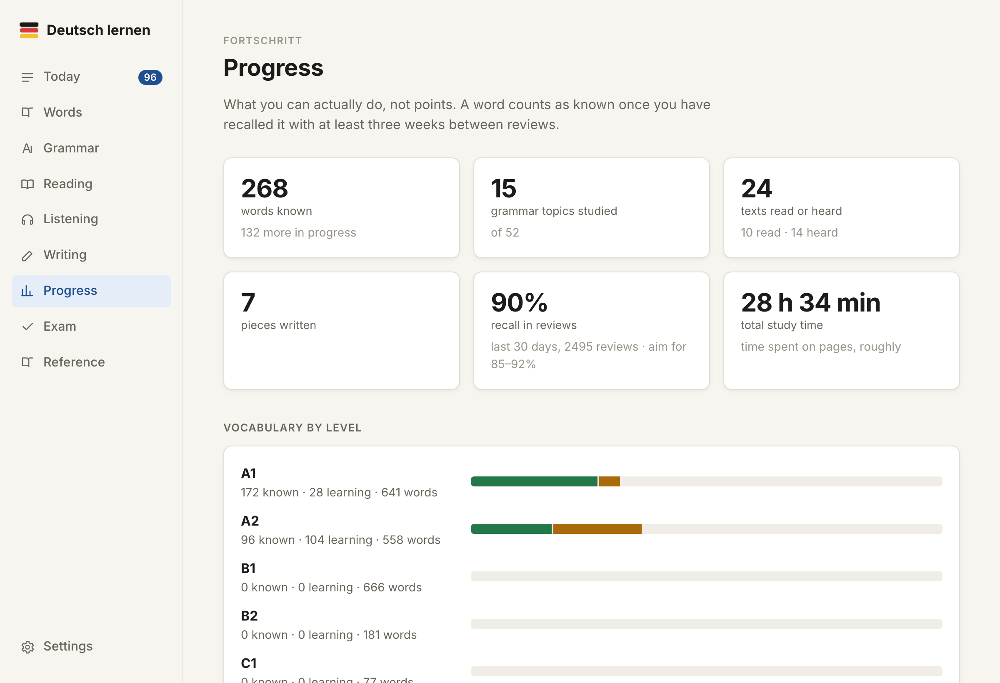
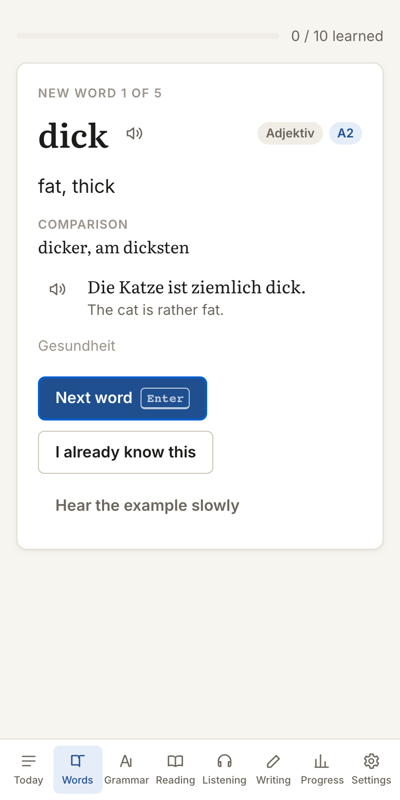

# Deutsch lernen 🇩🇪

A German course you can do in your browser, from A1 up to C1.

[](https://github.com/matthewedwarddavidson/deutsch-lernen/actions/workflows/pages.yml)

### [Open the app →](https://matthewedwarddavidson.github.io/deutsch-lernen/)

<picture>
  <source media="(prefers-color-scheme: dark)" srcset="docs/screenshots/today-dark.png">
  
</picture>

## Why I made it

I'm learning German: I'm at A2 and have just started a B1 course. The apps I tried were either endless flashcards or games built around keeping a streak going. Neither did much for my reading or writing, so I built something closer to what a course does.

Each day it suggests a mix: review what's due, learn a few new words, then read, listen or write something. Grammar is explained in English with tables and examples, and the exercises come back later as reviews. Answers are typed rather than ticked, so you find out whether you can actually produce *der Termin* or just recognise it.

The voices are recordings rather than the browser's robot voice. There are four of them, made with an open-source model and checked with speech recognition. There's no AI tutor and nothing to pay for. Your progress stays in your browser unless you sign in to sync between devices.

The research behind the design, with sources, is in [docs/research.md](docs/research.md).

## A look around

<table>
  <tr>
    <td width="50%"><br><b>Reviews.</b> Typed recall, gap-fills in context and grammar, all in one spaced queue.</td>
    <td width="50%"><br><b>Grammar.</b> 52 topics with short explanations, tables, common mistakes and exercises.</td>
  </tr>
  <tr>
    <td><br><b>Reading.</b> Graded texts. Guess a word's meaning before it's shown, then save it to your reviews.</td>
    <td><br><b>Listening.</b> Dialogues, announcements and talks. Questions first, transcript after.</td>
  </tr>
  <tr>
    <td><br><b>Writing.</b> Goethe-style tasks with useful phrases, a live checklist, then a model answer to compare.</td>
    <td><br><b>Progress.</b> Words known by level, recall rate and study time, not points.</td>
  </tr>
</table>



### Works on your phone

The layout adapts to small screens, with navigation at the bottom. Dark mode follows your system setting or can be set by hand.

<br clear="right">

## What's in it

| Area | What it does |
| --- | --- |
| **Today** | Reviews due, new words, the next grammar topic, a text to read and listen to, a writing task, and how your week splits across input, output, study and fluency. |
| **Words** | ~2,100 words across 16 themes, A1–C1, each with article, plural or verb forms, usage and an example. Learn in batches of five: study, then recall from English. Add your own words, for example from your course. A timed speed round on known words trains fluency. |
| **Reviews** | One FSRS queue for everything: recognition (German → English), production (English → German, typed, with article; alternates with gap-fills in context), irregular verb forms, grammar exercises and your mistakes you note from your own writing. Marking forgives typos but not wrong endings or auxiliaries. |
| **Grammar** | 52 topics from A1 to C1: explanation, tables, examples, common mistakes, then exercises (gap, choice, word order, transformation). Finished topics feed their exercises into reviews. |
| **Reading** | 37 graded texts across genres. Tap any word for a gloss or to save it with its sentence. Comprehension questions, read-aloud, and a timed fluency re-read. |
| **Listening** | 36 dialogues, announcements, interviews and talks with distinct recorded voices; questions first, transcript after. Dictation with word-by-word feedback. |
| **Writing** | Goethe-style tasks (A1–C1) with useful phrases, live word and connector counts and model answers. Note your mistakes and they come back in reviews. A timed exam simulation is on the Exam page. |
| **Progress** | Words known by level, recall rate, review forecast, study time, grammar mastery. |

## Run it

```bash
npm install
npm run dev        # http://localhost:5173
```

Other scripts:

```bash
npm test           # unit and content tests (Vitest)
npm run test:e2e   # end-to-end smoke tests (Playwright)
npm run build      # type-check and production build into dist/
npm run format     # Prettier
```

Built-in words, examples, grammar sentences, texts and dialogues come with recordings made by a neural voice (see below). Your own words use the browser's voice: Microsoft Edge has free natural German voices (Katja, Conrad); on macOS a Premium voice (Anna, Petra) helps in other browsers.

## Privacy

The hosted app is a static site. Progress, writing and your own words are stored in your browser's localStorage, so nobody else visiting the site can see them. Nothing leaves the browser unless you sign in.

Signing in with Google (Settings → Sync across devices) keeps a copy in Firestore under `users/{uid}/deutsch-lernen/`, readable only by your account, and merges progress from each device. It needs `VITE_FIREBASE_API_KEY`, `VITE_FIREBASE_AUTH_DOMAIN`, `VITE_FIREBASE_PROJECT_ID` and `VITE_FIREBASE_APP_ID`: in `.env.local` for development and as repository secrets for the deploy. Without them, sign-in is hidden. The Firestore rules must allow `users/{uid}/{document=**}` only for that `uid`, and the Pages domain must be an authorised domain in Firebase Authentication.

Storage is per browser and per address, so the hosted app and a local copy keep separate progress. Use Settings → Download backup / Restore to move between them.

## Recorded voices

Recordings are made offline with [Chatterbox Multilingual](https://github.com/resemble-ai/chatterbox) (MIT) and stored in `public/audio/` as AAC. Lena, Katrin, Jonas and Markus are cloned from short excerpts of public-domain [LibriVox](https://librivox.org) recordings in `scripts/voices/`. Chatterbox sometimes garbles short or unusual input, so the build transcribes every sentence with [Whisper](https://github.com/SYSTRAN/faster-whisper) (MIT) and regenerates it if the words don't match. After five failures it uses [Piper](https://github.com/rhasspy/piper) (CC0 voices Thorsten and Kerstin) instead, listing the sentence in `audio-build/fallbacks.txt`.

After changing built-in content, record the new sentences (macOS with Apple silicon; needs `afconvert` and Python 3.11):

```bash
python3.11 -m venv .venv-tts && .venv-tts/bin/pip install chatterbox-tts faster-whisper piper-tts "setuptools<81"  # once
mkdir -p audio-build/chatterbox audio-build/whisper-small && cd audio-build                              # once
for f in ve.pt t3_mtl23ls_v2.safetensors s3gen.pt grapheme_mtl_merged_expanded_v1.json conds.pt Cangjie5_TC.json; do
  curl -L -o chatterbox/$f https://huggingface.co/ResembleAI/chatterbox/resolve/main/$f; done
for f in config.json model.bin tokenizer.json vocabulary.txt; do
  curl -L -o whisper-small/$f https://huggingface.co/Systran/faster-whisper-small/resolve/main/$f; done
for v in de_DE-thorsten-high de_DE-kerstin-low; do ../.venv-tts/bin/python -m piper.download_voices $v; done && cd ..
npx tsx scripts/collect-speech.ts > audio-build/requests.json
scripts/record_all.sh
```

Only missing sentences are recorded; a full rebuild takes several hours. Anything without a recording falls back to the browser voice.

## Word frequency

New words are introduced most common first. `src/content/words/frequency.ts` holds a rank per word, generated from German OpenSubtitles counts in [FrequencyWords](https://github.com/hermitdave/FrequencyWords) by Hermit Dave (CC BY-SA 4.0). After adding words, download `de_50k.txt` from that repository into `audio-build/freq/` and run `npx tsx scripts/frequency.ts > src/content/words/frequency.ts`.

## Code map

```
src/
  content/       words (pipe-separated lists), grammar topics, texts, tasks
  lib/           check (answer marking), srs (FSRS), cards (queue), store (state),
                 speech (recordings + browser voices), verbForms,
  components/    shared UI
  pages/         one file per section
scripts/         speech collection and recording, word frequency, demo data and screenshots
e2e/             Playwright smoke tests
docs/research.md
```

Word lists use one line per word:

```
KIND | german | grammar | usage | english | example with {target} | example in English
N | die Wohnung | Wohnungen | | flat | Wir suchen eine größere {Wohnung}. | We're looking for a bigger flat.
```

Content tests check ids, articles, verb forms, gaps, glossaries and answer indexes, so run `npm test` after editing content.

To refresh the README screenshots, start `npx vite --port 5174`, then run `npx tsx scripts/demo-state.ts > /tmp/demo-state.json && node scripts/readme-screenshots.mjs /tmp/demo-state.json`. The demo state is two months of simulated study.
